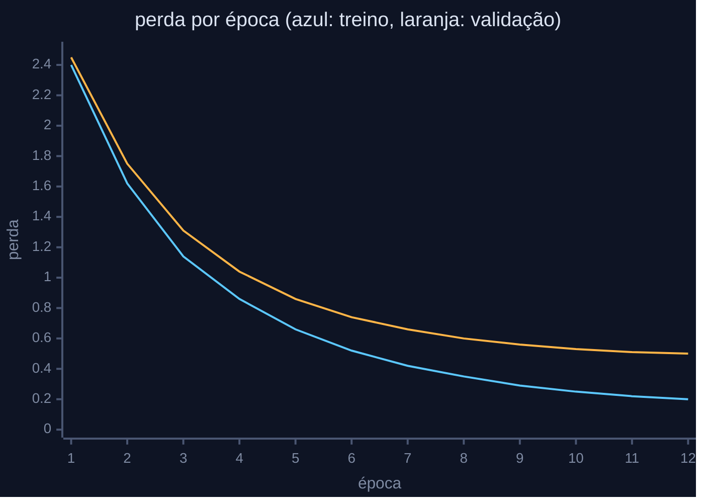

<div align="center">


<a href="https://www.linkedin.com/in/jmendesvictor/"></a>
<a href="mailto:jonh_victor@outlook.com"></a>
<a href="LINK_DO_ARTIGO"></a>

</div>

### `~/perfil.yaml`

```yaml
nome: João Victor Mendes de Lira
cargo:
  - Desenvolvedor de software
  - Mestrando em Engenharia da Computação (PPGEC/UPE)

pesquisa:
  linha: machine learning aplicado à saúde pública
  projeto: previsão do desfecho do tratamento da tuberculose no Brasil
  dados: SINAN, 2014 a 2024
  status: em andamento

docencia: Tópicos Avançados em Inteligência Artificial, UPE Caruaru
experiencia: [ERPs têxteis, logística, plataformas de gestão]

stack:
  linguagens: [JavaScript, TypeScript, Python, PHP]
  web: [React, Next.js, Node.js, Tailwind CSS, Vite]
  dados_ia: [scikit-learn, PyTorch, TensorFlow]
  bancos: [PostgreSQL, SQL Server, MongoDB]
```

### `~/treino.log`



### `~/atividade`

<div align="center">
  
  
</div>
